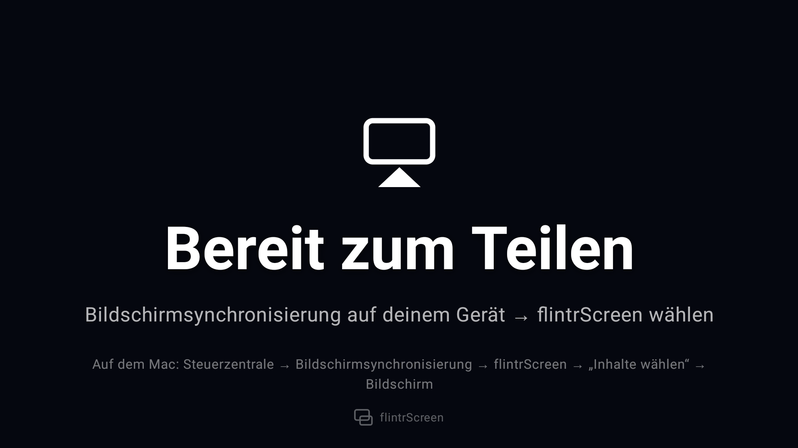

# flintrScreen

Native AirPlay receiver for Android TV — mirror your **Mac** or **iPad** to your TV. **No ads, no accounts, no nonsense.**




## What it does

flintrScreen is a native Kotlin Android TV app that turns an Android TV device into an AirPlay screen receiver:

- **Screen mirroring** from macOS and iPadOS via AirPlay
- **Audio** from AirPlay to your TV speakers (AAC / ALAC, native playback via Oboe)
- **Hardware video decoding** through Android MediaCodec (H.264), live stats in logcat
- **TV-first UI**: launch the app, see *"Ready to share"*, connect from your device — two taps, no settings, no overlays while mirroring
- **Ad-free and silent by design** — no telemetry, nothing ever leaves your local network

## Why

Commercial AirPlay receiver apps on Android TV are ad-ridden. This one isn't.

## Requirements

- An Android TV device, Android 6.0+ (API 23+) — 32-bit and 64-bit supported (fat APK)
- A sender: a Mac (macOS) or iPad (iPadOS) on the same local network

## Build

Requires JDK 17, Android SDK and NDK.

```bash
git clone --recurse-submodules https://github.com/kabelklaus/flintrScreen.git
cd flintrScreen
./gradlew assembleDebug
```

The APK lands at `app/build/outputs/apk/debug/app-debug.apk` (arm64-v8a + armeabi-v7a).

UxPlay security patches are applied automatically by the `applyUxplayPatches` Gradle task at build time — the submodules stay pinned to known-good upstream commits.

## Install

```bash
adb install -r app/build/outputs/apk/debug/app-debug.apk
```

## Usage

1. Open **flintrScreen** on your TV — it shows *"Ready to share"*.
2. On your **Mac**: Control Center → Screen Mirroring → **flintrScreen**.
   On your **iPad**: Control Center → Screen Mirroring → **flintrScreen**.
3. Done — your screen is on the TV.

## Security note

The receiver currently accepts AirPlay connections from **anyone on your local network** (no PIN pairing yet). Only use it on networks you trust — PIN pairing is planned for a future version.

## Disclaimer

> ⚠️ **This project was built with the help of AI** (LLM-assisted development). Bugs are possible — **use at your own risk**.
> Tested on Xiaomi Mi Box S (Android 8, 32-bit); other devices are untested.

## License

**GPL-3.0** — the AirPlay protocol engine is based on [UxPlay](https://github.com/FDH2/UxPlay) (GPL-3.0), embedded via JNI. See [LICENSE](LICENSE) and [NOTICE.md](NOTICE.md).
